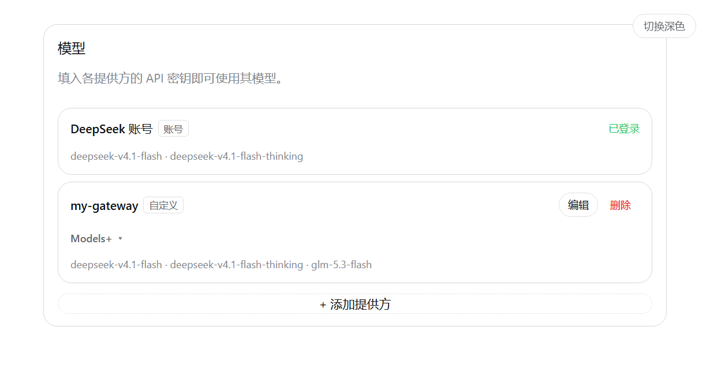
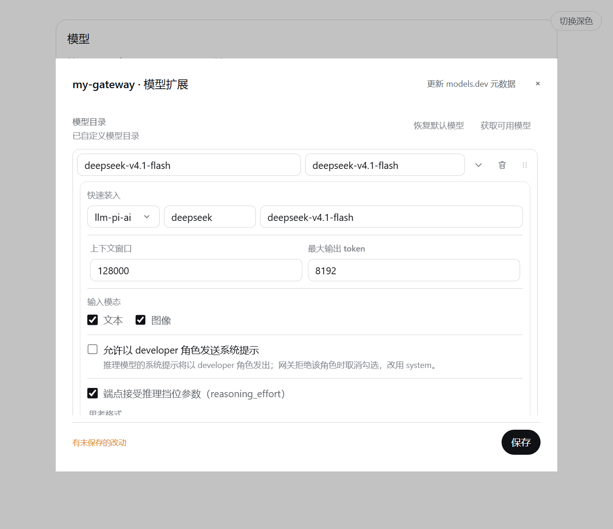

# dsh-model-extension
> 给 DeepSeek Harness 官方「模型」设置页加一层模型编辑器：目录快速装入、扩展参数与兼容开关

> **1.4.0-alpha.1** 起，本插件不再屏蔽官方模型设置页，而是通过官方扩展位插入 Models+ 设置弹层。遵循官方“在不改官方页的前提下加 UI”的设计前提。

[](./LICENSE) [](https://www.npmjs.com/package/dsh-model-extension) [](https://github.com/deepseek-ai/deepseek-harness) [](#安装)

> **作者建议（非AI编写）**
> 安装该插件或该类型插件：clone 仓库源码 -> 执行安全检查/扫描 -> 从源码构建 -> 安装

| 卡片里的入口 | 模型扩展弹层 |
| --- | --- |
|  |  |

## 功能

本插件是官方模型设置页的**增强面**，不是替代品：它在每个 `llm-pi-ai` 提供方卡片的「编辑 / 删除」下方加一个 `Models+` 入口，点开是这套模型的完整编辑器。提供方增删改、API 密钥、协议与重试策略仍由官方页负责，本插件不重复实现。

弹层里可以：

- **获取可用模型**：直接向端点询问它提供哪些模型，勾选后加入列表。
- **添加 / 删除模型**：手工建行，或删掉不再需要的行。
- **拖动排序**：行首手柄拖动，也可用 `Alt + ↑/↓`；这里的顺序就是模型选择器里的顺序。
- **折叠 / 展开**：默认收起只看模型 ID，点开编辑这一行的全部参数。
- **快速装入**（每行内）：从 `llm-pi-ai` 内置目录或 `models.dev` 元数据里挑一个模型，一次填好这一行的 ID、名称、上下文与输出上限、输入模态、推理挡位和兼容开关。
- **扩展参数**：上下文窗口、最大输出 token、输入模态（文本 / 图像）、developer 角色、`reasoning_effort` 开关、思考格式、推理挡位表（7 档，线上取值可改），以及 `compat` 下的其余开关。

推理挡位与兼容开关会按该路由的协议过滤：例如 Gemini 只提供四档且线上取值固定，不会配出「保存成功、首次请求失败」的配置。

编辑期间的改动留在本地草稿，点「保存」时一次写盘（`$DSH_HOME/settings.yaml`）。写入带 revision fence——读到的是旧版本时报告冲突，不会覆盖别处的改动。

`models.dev` 元数据需要点一次弹层头部的「更新 models.dev 元数据」（落到 `$DSH_HOME/models.json`），也可以自行放好该文件；`llm-pi-ai` 内置目录随 DSH 安装，无需下载。

## 安装
### Web / CLI（`web` profile）

```bash
# github
dsh plugin --profile web add github:lovezi0/dsh-model-extension

# npm
dsh plugin --profile web add dsh-model-extension
```

### Desktop（Electron 应用）
只能在 Desktop 应用内的**插件页**安装，安装源填以下任意一种：

- `github:lovezi0/dsh-model-extension`（git 源）
- `dsh-model-extension`（npm 源）
- ~~本机某一**绝对路径**（开发自测）~~ **不推荐**

## 从源码构建

构建自包含——需要复用的官方逻辑模块已 vendor 至 `src/client/vendor/`（`operations` / `schema-operations`，见文件头来源标注），无需 DeepSeek Harness 宿主源码：

```bash
npm install
npm run build
```

## 版本历史

- **1.4.0**
    - **1.4.0-alpha.1**
        - 💥恢复官方模型设置页设置
        - 💥移除[模型+]设置页面
        - 🔥通过官方扩展位插入 Models+ 设置弹层

- **v1.3.3-legacy** — 1.0.0 至 1.3.3-legacy 期间，本插件持续适配 DeepSeek Harness 多个版本（含 Desktop）、增强模型快速装入与拖动排序能力；v1.3.3 历史，见 [CHANGELOG.md](./CHANGELOG.md)
- **outdated（0.x）** — 开放deepseek harness内置模型扩展参数；v0.x 历史，见 [CHANGELOG.md](./CHANGELOG.md)

## 许可

MIT。包含自 [deepseek-harness](https://github.com/deepseek-ai/deepseek-harness)（MIT）的 vendored 官方逻辑模块与派生代码。